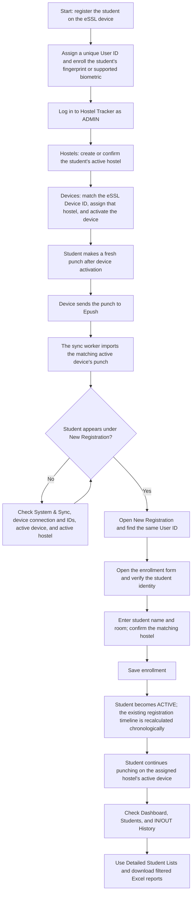

# Admin guide: eSSL registration to software enrollment

## Steps for the administrator

1. Register the student on the eSSL device with a unique User ID, and enroll the supported biometric. Device menu names vary by model; follow its enrollment procedure. Record the User ID accurately.
2. Log in to Hostel Tracker as ADMIN. On **Hostels**, confirm the student's hostel exists and is active.
3. On **Devices**, confirm the device's ID exactly matches the ID used in Epush. Assign it to that hostel and make it active **before the student makes the first punch for this workflow**. This setup can already be complete for an existing operational device.
4. Ask the student to make a fresh punch. The device must deliver it to Epush, and the synchronization worker must be running.
5. Open **New Registration** and locate the same User ID. A first-time imported punch creates a pending student automatically; enrolling a biometric on the device alone does not create a student in this application.
6. Open the enrollment form, verify the student's identity, enter their name and room, and confirm their hostel matches the device's hostel. Save enrollment.
7. Verify the student is ACTIVE on **Students**. Formal enrollment recalculates the existing registration timeline chronologically. The first valid event remains REGISTRATION; subsequent qualifying events follow the established IN/OUT sequence. Duplicate punches do not become additional IN/OUT events.
8. Use **Dashboard** and **IN/OUT History** to monitor activity. On **Detailed Student Lists**, select Currently IN, Currently OUT, 5 or more punches today, or OUT over 24 hours. Apply hostel/search filters and download Excel if needed.

## If the student does not appear

- Check **System & Sync** for synchronization status or errors.
- Confirm the punch reached Epush, its device ID matches the configured device, and both the device and hostel are active.
- Only punches at or after the latest device activation are eligible for import. Older punches from an inactive period are not imported automatically; use a fresh punch after activation.
- If that User ID is already enrolled, look under **Students** rather than expecting another pending registration. Do not reuse one person's biometric ID for another person.
- Use ordinary student profile editing for later room/name changes, rather than attempting enrollment again.

This guide describes normal authorized use of the application. Generating the guide did not create users, students, device records, or production attendance data.
