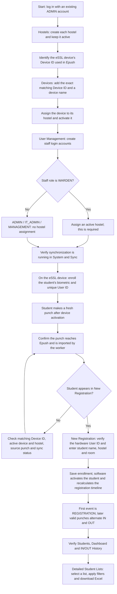

# Administrator setup and student enrollment flow

## How to follow the sequence

1. Use an existing administrator account to log in. Initial account provisioning is separate from this application usage flow.
2. Create the hostels before assigning devices or wardens. Active devices and wardens require an active assigned hostel.
3. Obtain the device identifier used in Epush, then enter that exact number in the application's Devices page. The device name is a display label; it does not determine matching. Configure the eSSL device's connection through the site's existing supported setup, if needed. Its menus depend on the device model.
4. Assign and activate the device before asking students to punch. Only matching active devices are imported. Newly activated devices import punches from activation onward; older punches are not automatically recovered.
5. Create staff accounts in User Management. WARDEN requires a hostel assignment. ADMIN, IT_ADMIN and MANAGEMENT do not. Staff accounts are software logins, not student biometric User IDs. Passwords require at least eight characters and at most 72 UTF-8 bytes.
6. Verify the synchronization worker is operating. A connected dashboard alone does not prove that biometric import is running.
7. Enroll each student on the eSSL device with a unique hardware User ID and biometric. Preserve that User ID across the hardware and software. This guide does not specify model-dependent eSSL menus.
8. Ask the student to make a fresh punch. After it reaches the source and synchronization processes it, an unknown student appears as pending enrollment in New Registration. The device supplies the initial hostel assignment.
9. Complete the pending student's name, hostel and room in New Registration and save enrollment. The software retains the hardware User ID, activates the enrollment, and recalculates its registration timeline. The first event is REGISTRATION, rather than an IN event; subsequent eligible valid punches alternate IN and OUT.
10. Verify the student in Students, Dashboard and IN/OUT History. Subsequent ordinary room/name edits should use student profile editing, rather than enrollment.
11. Use Detailed Student Lists for Currently IN, Currently OUT, five or more IN or OUT punches today, and OUT over 24 hours. Apply hostel/search filters and download Excel. Wardens can only see and export their assigned hostel. Today is midnight to midnight in Asia/Kolkata; IN and OUT counts are separate. Manual OUT changes also establish the OUT duration.

Creating this guide does not create accounts, enroll students, start services, or change either production database. Operators should follow their site's authorization for live administration.
